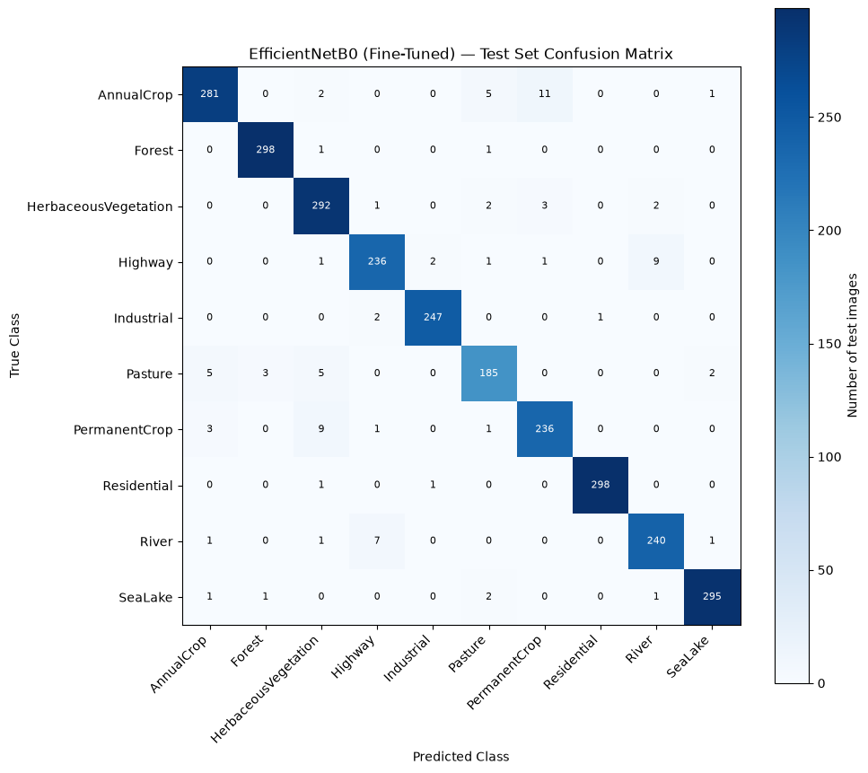

# EuroSAT Land-Cover Classification: CNN vs Transfer Learning vs Fine-Tuning

A TensorFlow/Keras comparative study on the EuroSAT RGB dataset (27,000 satellite patches, 64×64, 10 land-cover classes). It compares CNNs trained from scratch, six frozen ImageNet backbones, and fine-tuned models, then evaluates the selected model **once** on a held-out test set.

## Result

**Fine-tuned EfficientNetB0: 96.59% test accuracy** (macro F1 0.9643, 92 of 2,700 images misclassified).

| Stage | Best model | Validation accuracy |
|---|---|---:|
| CNN from scratch (Notebooks 03–04) | Baseline CNN | 88.00% |
| Frozen ImageNet features (05–06) | ResNet50 | 95.70% |
| Fine-tuning (07) | EfficientNetB0 | 96.67% (peak) |
| **Final test (08)** | **EfficientNetB0 (fine-tuned)** | **96.59% test** |



The main confusions are among AnnualCrop, PermanentCrop, Pasture and HerbaceousVegetation, and between Highway and River.

## Key Findings

All findings apply to this dataset, this single split, and single runs.

- **Transfer learning gave the biggest jump.** Training only a small head on frozen ImageNet features took five of six architectures from 88% (scratch CNN) to 92–96%. InceptionV3 (86.07%) was the exception; its 128×128 input is one possible factor, not tested.
- **Fine-tuning helped further.** Both fine-tuned models improved on their frozen versions; EfficientNetB0 improved most and was still improving at the end.
- **CNN tweaks were mostly noise.** Dropout was best (88.96%, about 26 images above baseline); depth, width and extra layers stayed near baseline; augmentation, BatchNorm and GAP did not help in these runs. The same combined configuration scored 81.33% and 73.41% in two runs, so single-run differences under a few points are unreliable.
- **Model ranking at the top is not firm.** ResNet50, EfficientNetB0 and DenseNet121 are within 0.55 points (about 15 images).
- **Test ≈ validation.** 96.59% test vs 96.48% validation for the evaluated model state.

## Experiments

**Setup shared by all notebooks:** stratified 80/10/10 split (21,600 / 2,700 / 2,700), `SEED = 42`, batch size 32, Adam, `EarlyStopping` on `val_loss` (patience 5, restore best weights), max 15 epochs.

### CNNs from scratch (Notebooks 03–04, 64×64, validation set)

| Experiment | Parameters | Best val. acc. |
|---|---:|---:|
| Baseline (3 conv blocks + Dense) | 684,490 | 88.00% |
| + Augmentation | 684,490 | 83.78% |
| + BatchNorm | 685,386 | 73.93% |
| + Dropout(0.5) | 684,490 | 88.96% |
| + 4th conv block | 520,906 | 88.07% |
| + Extra Dense layer | 692,106 | 88.41% |
| Global Average Pooling | 94,538 | 82.85% |
| Wider (64-128-256) | 1,551,882 | 88.04% |
| Augmentation + BN + Dropout | 685,386 | 81.33% |
| Same, re-run | 685,386 | 73.41% |

### Frozen backbones (Notebooks 05–06, 128×128, validation set)

Same head for all: `GlobalAveragePooling2D → Dropout(0.2) → Dense(10)`, Adam 1e-3, each model's own `preprocess_input`.

| Model | Val. accuracy | Val. loss |
|---|---:|---:|
| ResNet50 | 95.70% | 0.1567 |
| EfficientNetB0 | 95.26% | 0.1408 |
| DenseNet121 | 95.15% | 0.1444 |
| MobileNetV2 | 93.70% | 0.1814 |
| VGG16 | 92.15% | 0.2390 |
| InceptionV3 | 86.07% | 0.4882 |

### Fine-tuning (Notebook 07, validation set)

Stage A: frozen backbone. Stage B: top 20% of backbone layers unfrozen (BatchNorm kept frozen), Adam 1e-5.

| Model | Frozen | Fine-tuned (peak acc. / min loss) |
|---|---:|---:|
| ResNet50 | 95.70% | 96.11% / 0.1300 |
| EfficientNetB0 | 95.26% | 96.67% / 0.1081 |

EfficientNetB0 was chosen from validation results only, before the test set was read. ResNet50 was deliberately not evaluated on the test set, so the test set was never used to compare models.

## Final Test Evaluation (Notebook 08)

| Metric | Value |
|---|---:|
| Accuracy | 96.59% |
| Loss | 0.1148 |
| Macro precision / recall / F1 | 0.9647 / 0.9641 / 0.9643 |
| ROC-AUC (one-vs-rest, macro) | 0.9991 |

Every class has F1 above 0.93. Strongest: Residential (0.995), Forest (0.990), Industrial (0.988), SeaLake (0.985). Weakest: Pasture (0.932), PermanentCrop (0.942).

**Error analysis** (20 random errors plus the 5 most and 5 least confident): most sampled errors are low-contrast green fields or patchwork parcels, or narrow linear features that look alike for Highway and River. Low-confidence errors look hazy or blurry. These explanations are observations from small samples, not tested causes.

## Limitations

- **Random patch-level split:** neighbouring patches can be similar, so results may overstate performance on new regions.
- **No content-level duplicate check** across splits (only file paths were checked).
- **Single runs, single split, single dataset.** Notebook 04 shows run-to-run variation can be large.
- **128×128 input** for pretrained models, below their native resolution, to keep CPU training feasible.
- **Fine-tuning not tuned:** unfreeze fraction and learning rate were each chosen once; only two architectures were fine-tuned.
- **Accuracy was not the goal.** Fully fine-tuned models on EuroSAT can likely go higher; this project prioritizes a clean, honest comparison.

## Reproducibility

- Python 3.13 on Windows, **CPU-only**. Package versions were not recorded (see `requirements.txt`).
- Seeds are set, but determinism is not enforced, so exact numbers may differ on rerun.
- The file list is not explicitly sorted, so the split may differ on another OS or filesystem.
- No trained weights are saved. Each notebook is standalone and retrains what it needs. Notebooks 05–08 take hours on CPU (about 9.7 h for 06, 5.9 h for 07, 2.4 h for 08), so the recorded outputs are kept in the notebooks.
- Later notebooks reuse earlier results as fixed reference values typed into the code.

## Setup

```bash
pip install -r requirements.txt
```

Install Jupyter separately if needed. Pretrained ImageNet weights download automatically on first run (internet required).

**Dataset (not included):** download EuroSAT RGB from [Zenodo](https://zenodo.org/record/7711810) and place the 10 class folders directly in `data/EuroSAT_RGB/` (for example `data/EuroSAT_RGB/Forest/`). Each notebook reads `DATASET_ROOT = Path("data/EuroSAT_RGB")`; change it if you store the data elsewhere.

Run in order: `01 → 02 → 03 → 04 → 05 → 06 → 07 → 08`. Only Notebook 08 touches the test set.

## Notebooks

| Notebook | Purpose |
|---|---|
| `01_Dataset_Audit_Exploration` | Checks structure, counts, file type, size, RGB mode, readability; class distribution |
| `02_Data_Split_TensorFlow_Pipeline` | Stratified split with overlap checks; `tf.data` pipeline |
| `03_Baseline_CNN` | Baseline CNN from scratch |
| `04_CNN_Experiments` | Nine controlled CNN variations |
| `05_Transfer_Learning_Fundamentals` | Frozen MobileNetV2 feature extraction |
| `06_Transfer_Learning_Model_Comparison` | Six frozen backbones compared |
| `07_Fine_Tuning` | Fine-tuning ResNet50 and EfficientNetB0 |
| `08_Final_Evaluation_Error_Analysis` | One-time test evaluation, confusion matrix, error analysis |

## Project Structure

```
.
├── 01_…08_*.ipynb
├── figures/confusion_matrix.png
├── README.md
├── requirements.txt
└── .gitignore
```

## Tech Stack

Python, TensorFlow/Keras, scikit-learn, NumPy, pandas, Matplotlib, Pillow.

## AI Usage & Transparency

I used AI assistants to discuss the experiment design, help write and review code and README text, and cross-check numbers across notebooks. I ran all training locally, reviewed the code and results, and made the final decisions. All reported numbers come from my own executed runs.

## Dataset Citation

EuroSAT (RGB version) by Helber, Bischke, Dengel and Borth, based on Sentinel-2 imagery. Released under the MIT license per the [official repository](https://github.com/phelber/EuroSAT); Sentinel data terms: [Copernicus legal notice](https://sentinel.esa.int/documents/247904/690755/Sentinel_Data_Legal_Notice).

```bibtex
@article{helber2019eurosat,
  title   = {EuroSAT: A Novel Dataset and Deep Learning Benchmark for Land Use and Land Cover Classification},
  author  = {Helber, Patrick and Bischke, Benjamin and Dengel, Andreas and Borth, Damian},
  journal = {IEEE Journal of Selected Topics in Applied Earth Observations and Remote Sensing},
  volume  = {12},
  number  = {7},
  pages   = {2217--2226},
  year    = {2019},
  doi     = {10.1109/JSTARS.2019.2918242}
}
```
